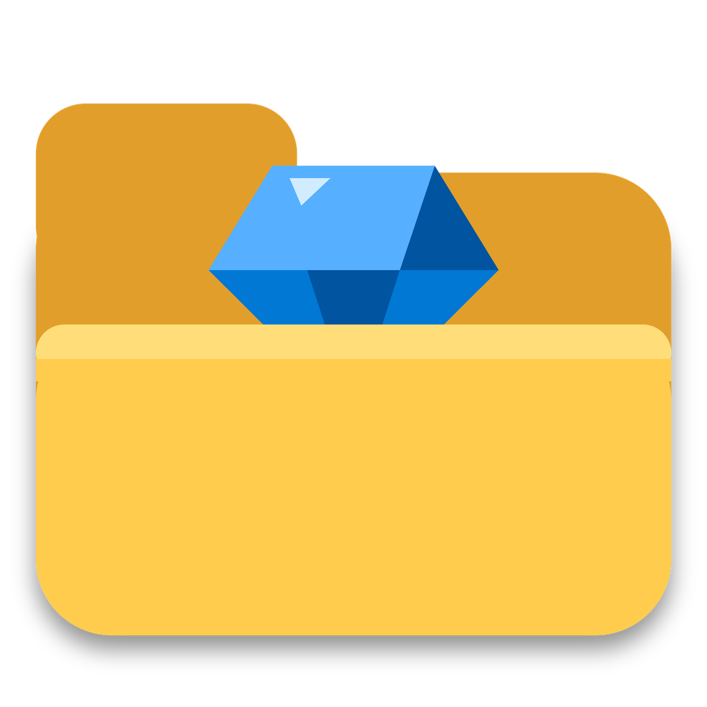
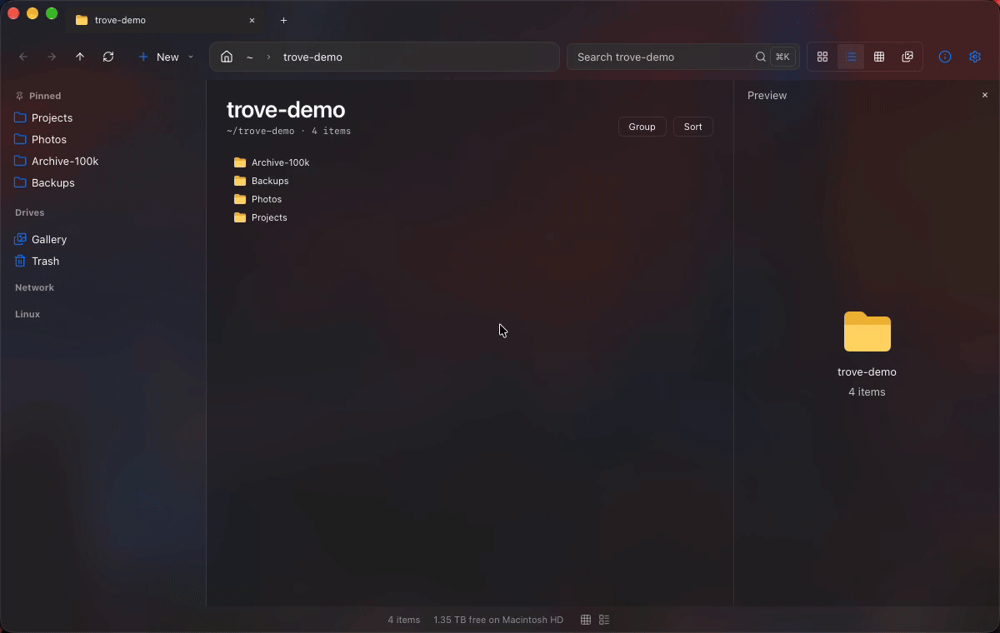
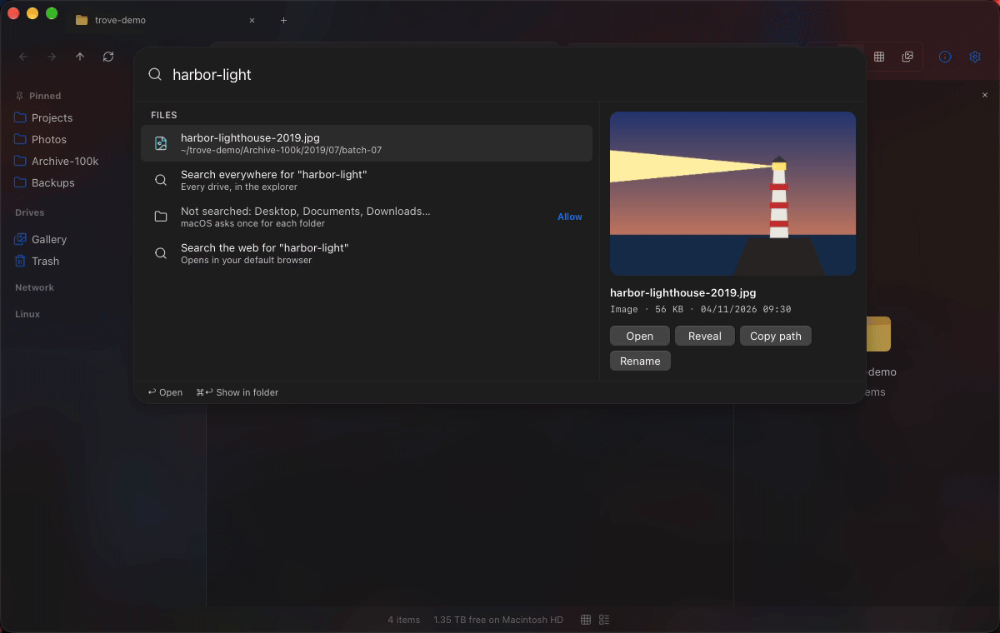
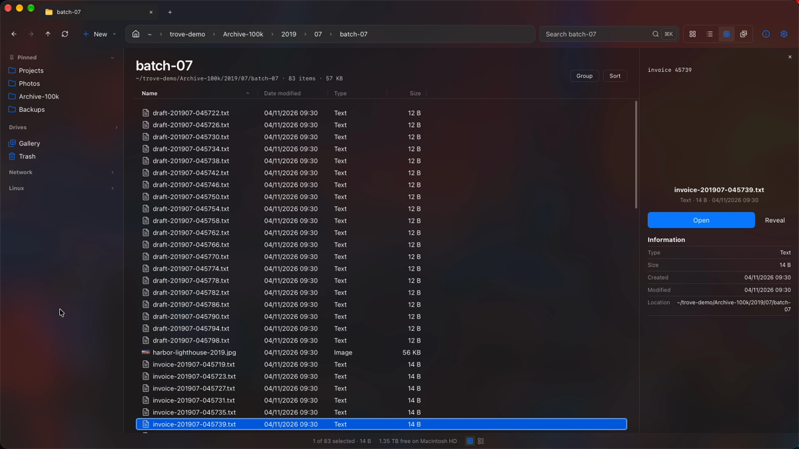
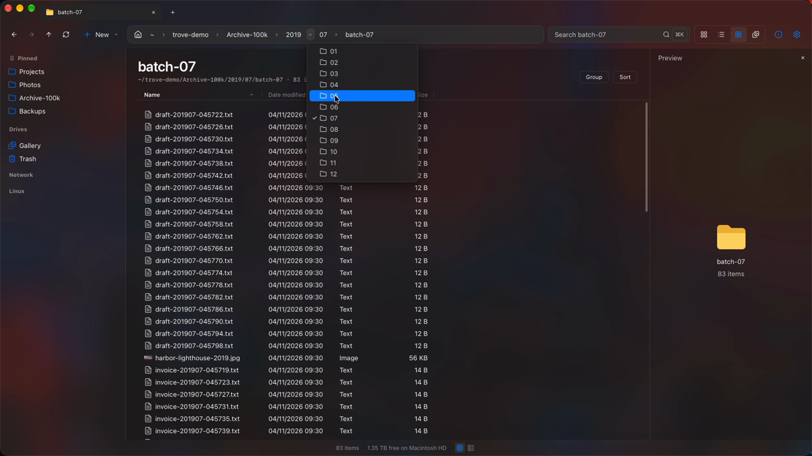
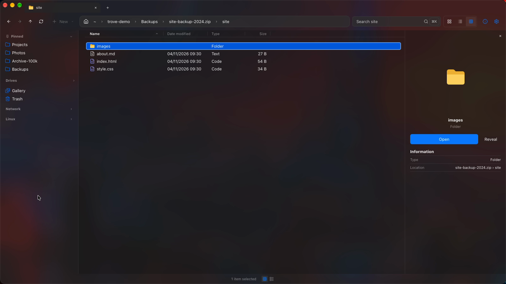

<div align="center">



# Trove

**A fast file explorer that feels the same on Windows, Mac and Ubuntu.**<br>
Find any file in a keystroke.

[](https://github.com/joyahmed/trove/releases/latest) [](#install) [](LICENSE)

### [⬇ Download Trove](https://github.com/joyahmed/trove/releases/latest)

Free · No tracking · Rust + Tauri 2 + Svelte 5

<br>



</div>

<br>

## Why I built this

I work on Windows, Ubuntu and a Mac every day. Three machines, three file managers, three sets of keys in my hands. And on Windows, Explorer felt slow with big folders. A network drive that was offline could freeze the whole window.

So I built **Trove**: one file explorer, the same on all three, with the things I kept reaching for built right in. A search box I can open from anywhere, a terminal under the file list, and archives that open like folders. It's free, and it stays on your machine.

I use it every day. If something feels off, tell me.

## A quick look

<table>
  <tr>
    <td width="50%" valign="top">
      <br>
      <b>Find anything in a keystroke.</b> <kbd>Ctrl</kbd>+<kbd>K</kbd> searches files, apps and actions, with a preview beside the results.
    </td>
    <td width="50%" valign="top">
      <br>
      <b>Big folders, no waiting.</b> A tree of 100,000 files scrolls smoothly. The details pane shows the file you're on.
    </td>
  </tr>
  <tr>
    <td width="50%" valign="top">
      <br>
      <b>Jump across folders.</b> The arrow next to each folder in the path lists its subfolders, like in Explorer.
    </td>
    <td width="50%" valign="top">
      <br>
      <b>Archives open like folders.</b> Walk into zip, 7z, tar and RAR files, and extract with undo.
    </td>
  </tr>
</table>

## Highlights

- 🔎 **Find**: <kbd>Ctrl</kbd>+<kbd>K</kbd> for files, apps and actions. A global shortcut opens the same search over any app.
- 🗂 **Tabs**: real tabs that come back after a restart. Save a group of tabs as a named set.
- ↩️ **Undo**: every disk action, even after you restart Trove. An undo history for older actions.
- 📦 **Archives**: open zip, 7z, tar and RAR like folders. Extract all, with progress and undo.
- 💻 **Terminal**: a terminal pane under the file list (<kbd>Ctrl</kbd>+<kbd>&#96;</kbd>). With a shell that reports its folder (fish, or one line in your shell setup), `cd` moves the list too.
- ⌨️ **Your keys**: change any shortcut. Trove tells you when a key is already taken.
- 🔒 **Private**: no telemetry, no background network calls, no auto-updates.

<details>
<summary><b>Everything it does</b> (click to open)</summary>

### Find

- Press <kbd>Ctrl</kbd> + <kbd>K</kbd> to find anything: files, apps and Trove's own actions in one list.
- A global shortcut opens the same search as a small floating box over any app, like Spotlight on a Mac.
- A preview card shows the file you're on: text, images, PDFs, a folder summary. Open, reveal, copy the path or rename from there.
- Type `*.pdf` (or any extension) and you get a "Search for *.pdf" row.
- It does sums too (type `12*7`), and can send what you typed to the web search you pick. Nothing goes out until you press Enter.

### Browse

- Real tabs. Save a group of tabs as a named tab set and open it again later.
- Your tabs can come back after a restart.
- The little arrow next to each folder in the path lists its subfolders, like in Explorer.
- Turn the navigation pane, preview pane, details pane, check boxes and file extensions on or off.
- Folder sizes right in the list.
- Every shortcut can be changed in Settings > Keyboard. Trove tells you if a key is already taken.
- An Applications place, and you can uninstall an app from there.
- "I'm coming from": pick Windows, Mac or Linux and Trove uses the words you're used to (Recycle Bin or Trash, This PC or This Mac).

### Files and archives

- Undo for every disk action, and it still works after you restart Trove.
- An undo history, so you can undo an older action when nothing after it touched the same files.
- Open zip, 7z and tar files like folders.
- Open and extract RAR files. Trove never creates RAR files.
- Extract all into a folder you choose, with progress, a choice when files clash, and undo.
- When a file won't delete because something has it open, Trove tells you which program.
- Drag files out to a browser upload box, an email, or another app.

### Terminal

- A terminal pane under the file list. <kbd>Ctrl</kbd> + <kbd>&#96;</kbd> opens it.
- With a shell that reports its folder, typing `cd` moves the file list with you. fish does this out of the box. For zsh, bash or PowerShell, add the one line shown next to **Follow folder** in Trove. The default zsh on a Mac does not report it.
- Paste the paths of the files you picked straight into the terminal.

### Windows

- Windows' own right-click items (VS Code, Git Bash, 7-Zip and the rest) inside Trove's one menu. No "Show more options".
- A network share that doesn't answer never freezes the window. You see "Still reaching <server>…" with a Cancel button, and your local drives show right away.
- Sign in to a share that asks for a password.
- Paths longer than 260 characters just work.
- WSL: a green dot on the distros that are running, a fast search that runs inside the distro, and a WSL folder you go back to shows up at once.
- OneDrive badges (online only, on this device, always kept), plus "Keep on this device" and "Free up space".
- "Retry as administrator" when a file action is denied.
- Set Trove as the default for <kbd>Win</kbd> + <kbd>E</kbd> and folder clicks, and undo that any time.

### Mac

- A Mac asks permission before an app reads Desktop, Documents or Downloads. Trove doesn't touch those folders until you open them yourself, or press **Allow** in Settings. Searches show which folders they skipped.
- Network drives stay untouched until you open one, so no surprise permission pop-ups.
- Previews for HEIC photos and videos.

### Linux

- Tested on Ubuntu. Your apps from the desktop's own menu show up in Trove, and you can remove one the system's own way.
- A dead network mount (NFS, CIFS, sshfs) can't hang Trove.
- Set Trove as the app that opens folders, and put the old one back any time.

</details>

## Install

Download from the [Releases page](https://github.com/joyahmed/trove/releases/latest).

| System | File | First launch |
|---|---|---|
| **Windows** | `Trove_<version>_x64-setup.exe` | Windows warns you: click **More info**, then **Run anyway**. |
| **Mac** (Apple silicon + Intel) | `Trove_<version>_universal.dmg` | Drag Trove to Applications. macOS blocks it the first time: open **System Settings > Privacy & Security**, scroll down, click **Open Anyway**. [Step by step](docs/install/mac.md) |
| **Ubuntu** | `Trove_<version>_amd64.deb` or `.AppImage` | `sudo apt install ./Trove_<version>_amd64.deb`, or make the AppImage executable and run it. [Step by step](docs/install/linux.md) |

Trove isn't signed by a known publisher yet, which is why your system warns you. There are no automatic updates yet: install the new version over the old one. Each release has a `SHA256SUMS.txt` to check your download.

## Watch it

**[▶ Watch the 40-second Short](https://youtube.com/shorts/MFJlusVQLhg)**. More of what I build: [youtube.com/@joysbuilds](https://www.youtube.com/@joysbuilds).

## Privacy

What Trove never does:

- No telemetry, no analytics, no tracking. There's no code for it.
- No network calls in the background. The web search row builds a link while you type and opens it in your browser only when you press Enter.
- No automatic updates. The release builds don't carry an updater.
- On a Mac, it never reads inside Desktop, Documents, Downloads and the other guarded folders until you open them or press **Allow**.
- It never steps onto a network drive on its own. Only when you open it.

Logs stay in Trove's own folder on your machine.

## Build from source

You need [Rust](https://rustup.rs), [Bun](https://bun.sh) and Tauri 2's system libraries for your OS (on Linux: WebKitGTK 4.1, GTK 3 and friends, see the Tauri prerequisites page). The RAR support builds a small C++ library, so a C++ compiler has to be there too (MSVC, clang or g++).

```
bun install --frozen-lockfile
bun run tauri dev                             # run it while you work on it
bun run build:installer                       # Windows installer
bun run tauri build                           # Mac app and .dmg
bun run tauri build --bundles deb,appimage    # Ubuntu .deb and AppImage
```

`bun run gate` runs everything I run before a change goes in: type check, lint, tests, the build, then the Rust format check, clippy and tests. [CONTRIBUTING.md](CONTRIBUTING.md) has the rest.

It's Rust and Tauri 2 on the back, Svelte 5 and Tailwind on the front.

## License

MIT. See [LICENSE](LICENSE).

The fonts, icons and archive libraries Trove uses have their own notices in [LICENSES/](LICENSES). RAR support uses UnRAR by Alexander Roshal, under its own licence (`LICENSES/unrar.txt`), which only allows extracting. That's why Trove opens RAR files but never makes them.

---

<div align="center">

I build tools I use myself, from Bangladesh. If Trove saves you a few seconds a day, that makes me happy.<br>
Found a bug or want something? [Open an issue](https://github.com/joyahmed/trove/issues).

**Joy**

</div>
